# Package a Pico VR APK

English | [中文](./Android_Package_CN.md)

This tutorial explains how to package an Unreal Engine 5.5 Virtual Reality project that uses **MLSLabsRenderer** into an Android APK, then install and run it on a Pico headset.

Before you start:

- **Operating System**: Windows 10 or 11 (64-bit)
- **Unreal Engine**: 5.5.x
- **Plugin**: MLSLabsRenderer is already installed. See [Getting Started](./README.md) for download, environment setup, and Gaussian Splatting import.
- **Device**: a Pico headset and a USB cable

To package successfully, install MLSLabsRenderer under the engine directory `Engine\Plugins\Marketplace`, not inside the project `Plugins` folder.

---

## 1. Install the Android engine component

1. In the Epic Games Launcher, find the installed Unreal Engine 5.5. Click the dropdown next to **Launch** and open the installation options.

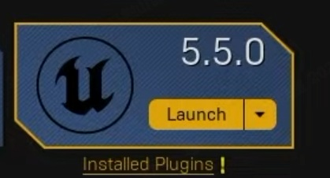

2. Under **Target Platforms**, check **Android**, then click **Apply**.

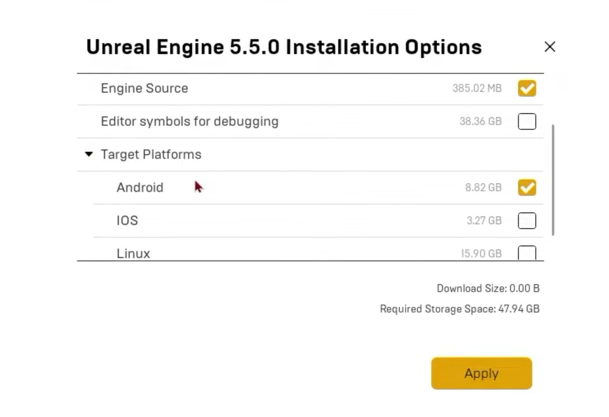

## 2. Install the NDK, SDK, and JDK

Install the NDK, SDK, and JDK versions required by this engine. Follow the official Unreal Engine 5.5 guide:

[Set Up Android SDK, NDK, and Android Studio using Turnkey](https://dev.epicgames.com/documentation/unreal-engine/set-up-android-sdk-ndk-and-android-studio-using-turnkey-for-unreal-engine?application_version=5.5)

## 3. Create a VR project

1. Create a new project. Choose the **Virtual Reality** template and set the project name. This tutorial uses `MyVRProject`.

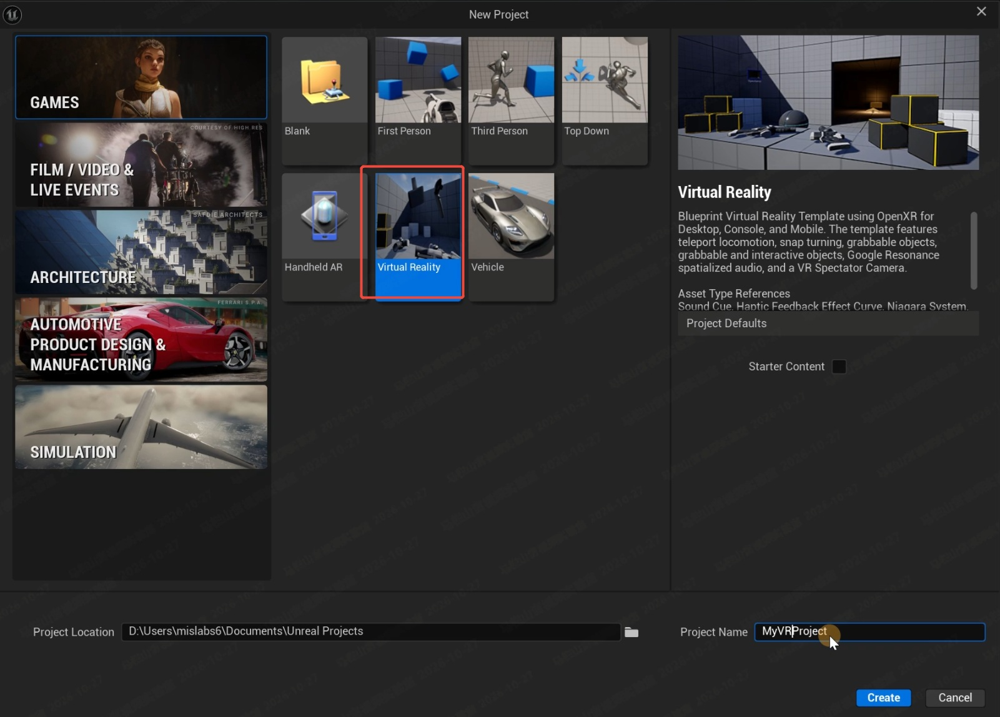

2. Download the **PICO OpenXR** plugin from the Pico developer site, then install it into the engine directory `Engine\Plugins\Marketplace`. Place it in the same folder as **MLSLabsRenderer**. Create the `Marketplace` folder if it does not exist.

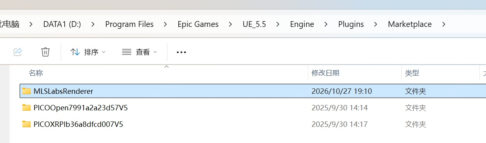

3. Open **Edit → Plugins**. Enable **MLSLabsRenderer** and **PICO OpenXR**, then restart the editor.

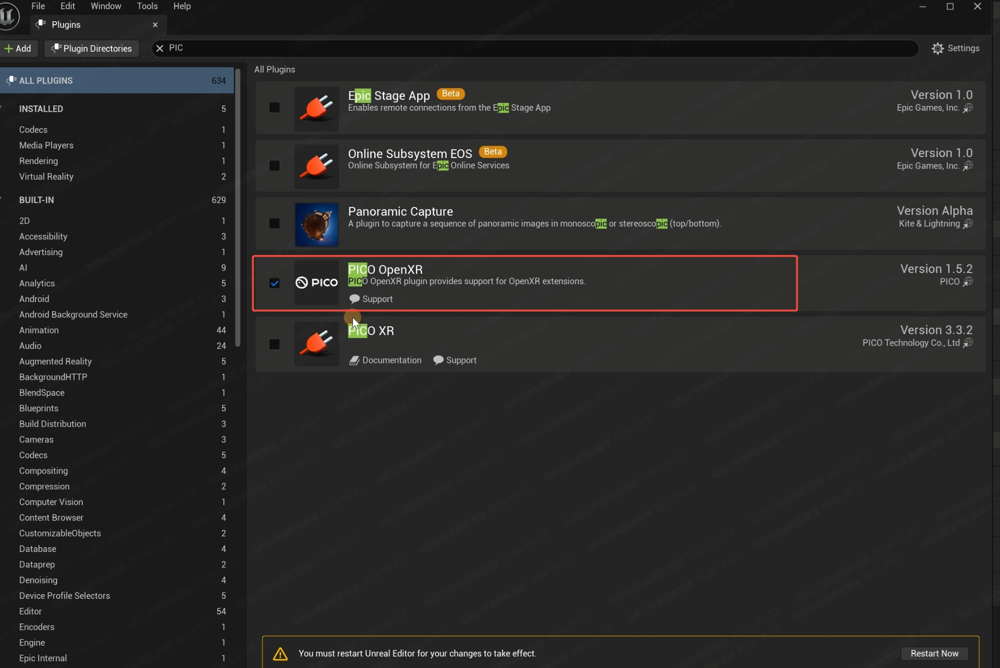

## 4. Import the Gaussian Splatting asset

Import the Gaussian Splatting asset, place it in the level, and adjust playback and transform. For the import and playback steps, see [Getting Started](./README.md).

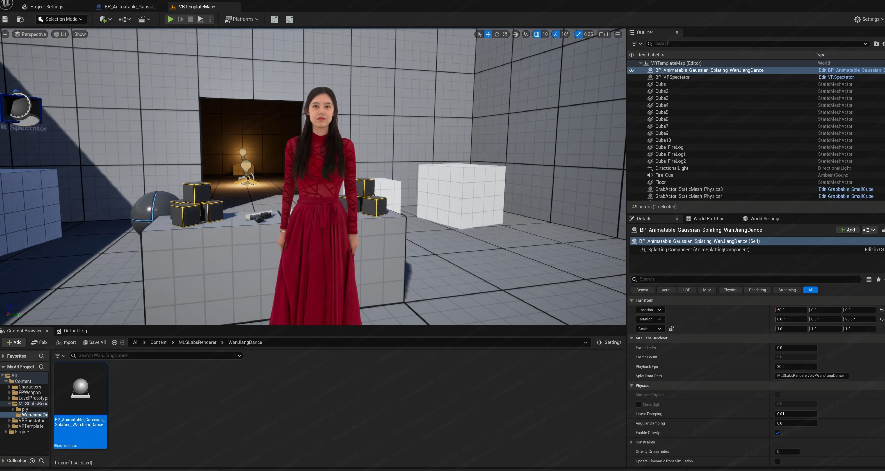

## 5. Configure Android packaging

1. Open **Project Settings**, find **Target Hardware**, and set **Optimize project settings for** to **Mobile** and **Scalable**.

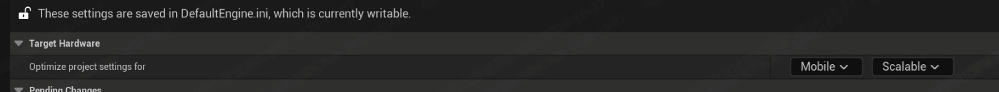

2. In **All Settings**, open **Project → Description**. Set **Project Name** and **Company Name**. The figure uses `TestVR` and `mlslabs`.

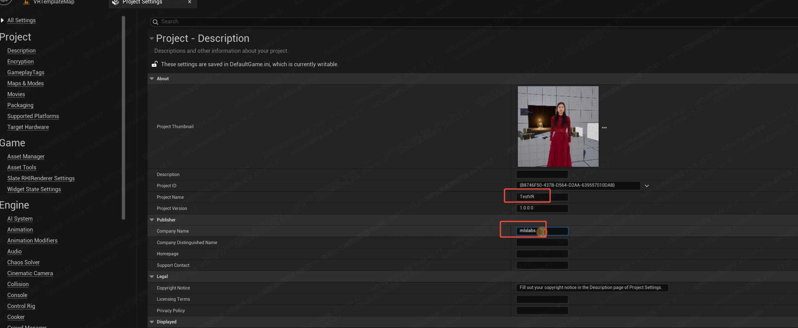

3. In the settings search box, type `list of maps`. Add the map used by this project to **List of maps to include in a packaged build**. The figure adds `/Game/VRTemplate/Maps/VRTemplateMap`.

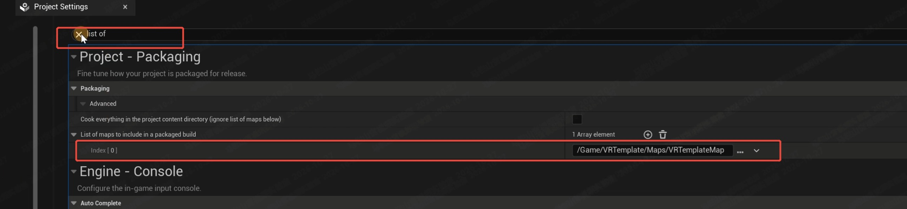

4. Open **Platforms → Android** and click **Configure Now**. 

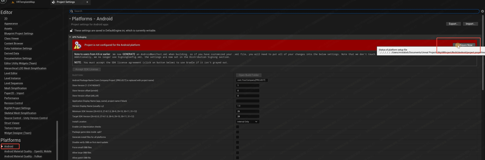

5. Fill in **Android Package Name**. Use a reverse-domain name, for example `com.mlslabs.testvr`. 

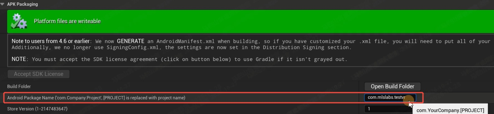

6. Set **Target SDK Version**. The figure uses `33`.

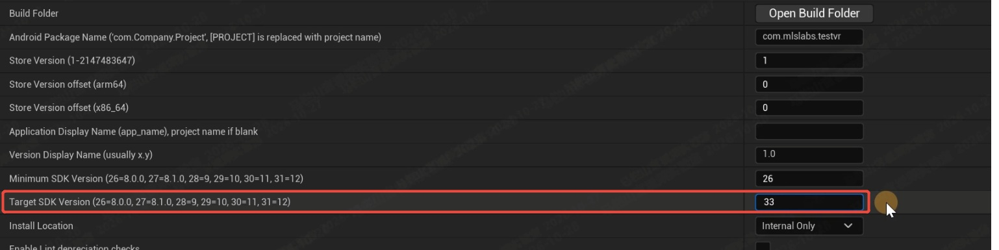

7. Open **Platforms → Android SDK**. Set **Location of Android SDK**, **Location of Android NDK**, and **Location of JAVA** to the paths installed in step 2. **SDK API Level** and **NDK API Level** must match those installs. The figure shows one valid UE 5.5 setup: NDK `25.1.8937393`, JDK 17, and SDK API level `android-34`.

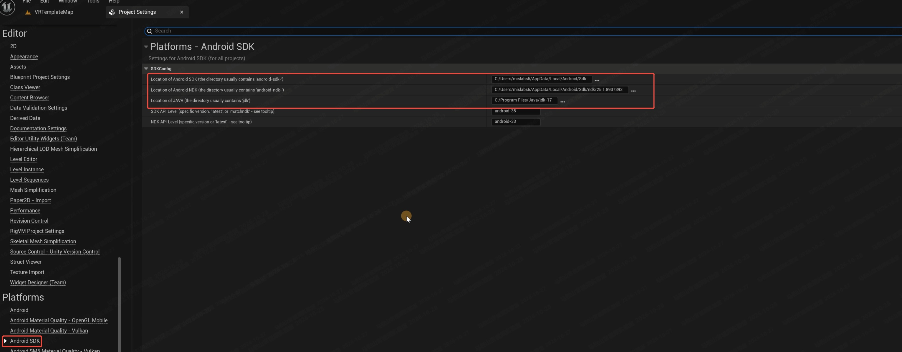

8. Open **Supported Platforms** and keep only **Android** and **Windows** enabled.

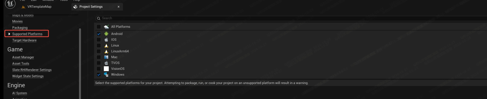

9. Review the settings above. Open **Platforms → Android**, choose **Development** or **Shipping** under **Binary Configuration**, then click **Package Project**. Wait until packaging finishes.

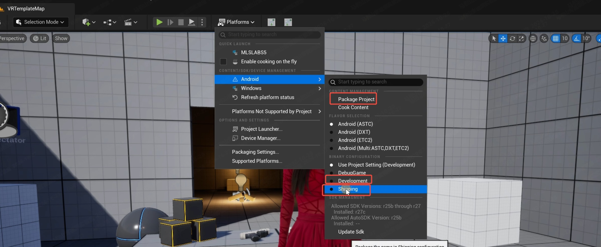

This plugin is provided as a Shipping build. Set Binary Configuration to Shipping, as shown in the figure.

## 6. Install and test on the Pico headset

1. Connect the Pico headset with a USB cable. A successful connection shows a system notification for the device. Allow the USB debugging prompt on the headset if it appears.

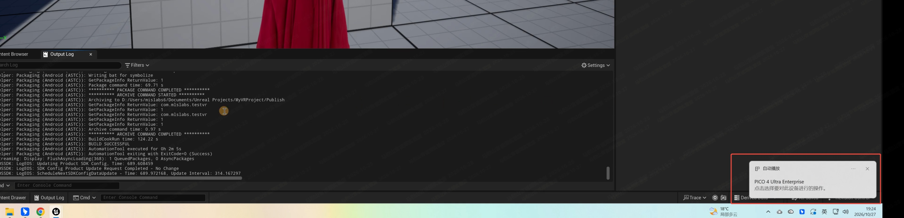

2. Open the packaged APK folder. In this example it is `MyVRProject\Publish\Android_ASTC`. Open Command Prompt in that folder.

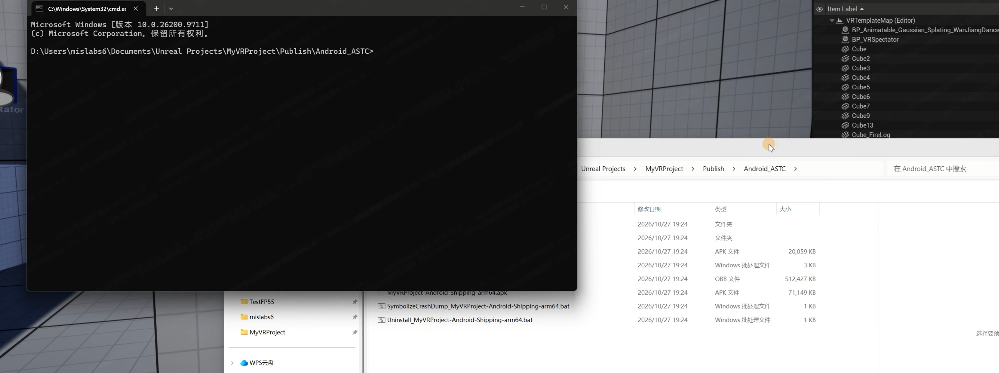

3. Run the generated install script. The file name follows the project name and the configuration you packaged. For this example, run:

`Install_MyVRProject-Android-Shipping-arm64.bat`

Wait until installation finishes. The same folder also contains a matching `Uninstall_*.bat` if you need to remove the app.

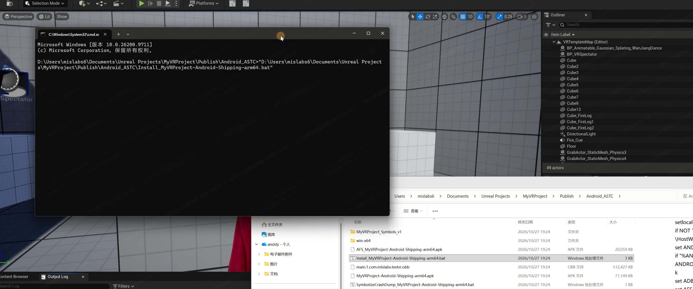

4. Unplug the USB cable. On the Pico headset, open and run the VR application.

