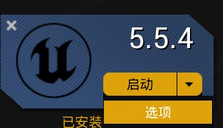
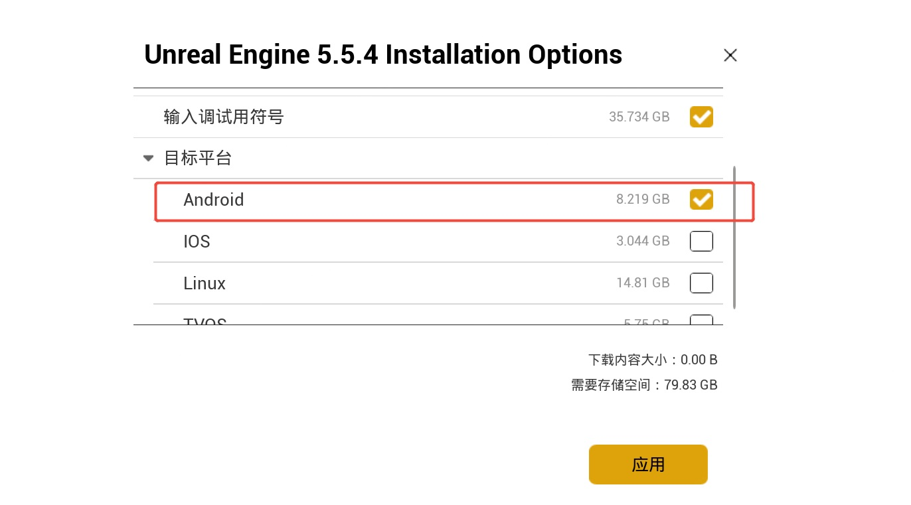

# 打包 Pico VR APK

[English](./Android_Package.md) | 中文

本教程说明如何把使用 **MLSLabsRenderer** 的虚幻引擎 5.8 Virtual Reality 工程打包为 Android APK，并安装到 Pico 头显上运行。

开始之前：

- **操作系统**: Windows 10 或 11（64 位）
- **虚幻引擎**: 5.8.x
- **插件**: 已安装 MLSLabsRenderer。下载、环境配置和高斯泼溅导入见 [快速入门](./README_CN.md)。
- **设备**: Pico 头显，以及一根 USB 数据线

为确保项目顺利打包，请将 MLSLabsRenderer 安装到引擎目录 `Engine\Plugins\Marketplace`，不要放在工程的 `Plugins` 文件夹中。

---

## 1. 安装 Android 组件

1. 在 Epic Games Launcher 中找到已安装的虚幻引擎 5.8。点击 **启动** 旁边的下拉按钮，打开安装选项。

2. 在 **目标平台** 中勾选 **Android**，然后点击 **应用**。

## 2. 安装 NDK、SDK 和 JDK

安装与当前引擎版本对应的 NDK、SDK 和 JDK。请按虚幻引擎 5.8 官方文档操作：

[使用 Turnkey 设置 Android SDK、NDK 和 Android Studio](https://dev.epicgames.com/documentation/unreal-engine/set-up-android-sdk-ndk-and-android-studio-using-turnkey-for-unreal-engine?application_version=5.8)

## 3. 新建 VR 工程

1. 新建工程，选择 **Virtual Reality** 模板，并填写工程名。本教程示例工程名为 `MyVRProject`。

2. 在 Pico 开发者官网下载 **PICO OpenXR** 插件，并安装到引擎目录 `Engine\Plugins\Marketplace`。它应与 **MLSLabsRenderer** 放在同一目录。如果没有 `Marketplace` 文件夹，请新建一个。

3. 打开 **编辑 → 插件**，启用 **MLSLabsRenderer** 和 **PICO OpenXR**，然后重启编辑器。

## 4. 导入高斯泼溅资产

导入高斯泼溅资产，放入关卡，并完成播放与位置调整。导入和播放的详细步骤见 [快速入门](./README_CN.md)。

## 5. Android 打包设置

1. 打开 **Project Settings**，找到 **Target Hardware**，将 **Optimize project settings for** 设为 **Mobile** 和 **Scalable**。

2. 在 **All Settings** 中打开 **Project → Description**，填写 **Project Name** 和 **Company Name**。图中示例为 `TestVR` 和 `mlslabs`。

3. 在设置搜索框中输入 `list of maps`，把当前工程使用的地图加入 **List of maps to include in a packaged build**。图中加入的是 `/Game/VRTemplate/Maps/VRTemplateMap`。

4. 打开 **Platforms → Android**，点击 **Configure Now**。

5. 填写 **Android Package Name**。使用反向域名，例如 `com.mlslabs.testvr`。

6. 设置 **Target SDK Version**。图中示例为 `33`。

7. 打开 **Platforms → Android SDK**，按第 2 步的实际安装路径填写 **Location of Android SDK**、**Location of Android NDK** 和 **Location of JAVA**。**SDK API Level** 与 **NDK API Level** 需要与已安装版本一致。图中是一套可用的 UE 5.8 配置：NDK `25.1.8937393`、JDK 17、SDK API Level `android-34`。

8. 打开 **Supported Platforms**，只保留 **Android** 和 **Windows**。

9. 再次确认以上设置。打开 **Platforms → Android**，在 **Binary Configuration** 中按需要选择 **Development** 或 **Shipping**，然后点击 **Package Project**，等待打包完成。

本插件以 Shipping 构建提供，请像图中一样将 Binary Configuration 设为 Shipping。

## 6. 在 Pico 设备上安装并测试

1. 用 USB 线连接 Pico 设备。连接成功后，系统会弹出该设备的通知。如果头显上出现 USB 调试提示，请允许调试。

2. 打开打包生成的 APK 目录。本示例为 `MyVRProject\Publish\Android_ASTC`。在该目录中打开命令提示符。

3. 运行生成的安装脚本。脚本名与工程名、打包配置一致。本示例运行：

`Install_MyVRProject-Android-Shipping-arm64.bat`

等待安装完成。同一目录下还有对应的 `Uninstall_*.bat`，需要卸载应用时可以运行它。

4. 拔掉 USB 线，在 Pico 设备上打开并运行该 VR 程序。

