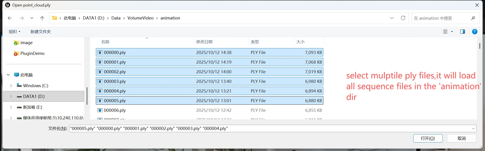

# MLSLabsRenderer-Pro

English | [中文](./README_CN.md)

# Introduction

[**MLSLabsRenderer-Pro**](https://mls4dlive.cn/) is a high-performance Unreal Engine 5 (UE5) plugin developed by [**MaLanShan Audio & Video Laboratory**](https://www.mlslabs.com.cn/). It is designed for real-time visualization, management, and scalable hybrid rendering of 3D Gaussian Splatting (3DGS) and dynamic Volumetric Video (4DGS).

Unlike traditional Niagara-based solutions, this plugin uses a custom rendering pipeline. It keeps a high frame rate while processing millions of Gaussians, and avoids the usual performance bottlenecks.

Available features:

- **High-Performance Static 3DGS**: Supports 7 million+ Gaussians at 50+ FPS (tested on an NVIDIA RTX 4070 Ti).
- **Dynamic 4DGS Playback**: Real-time volumetric video sequence playback, supporting 100,000+ Gaussians at 100+ FPS (tested on an NVIDIA RTX 4070 Ti).
- **Sequencer Integration**: Full support for UE Sequencer, with keyframe control over volumetric video playback.
- **High-Compression Static 3DGS**: Supports the `.sog` format for high-compression 3DGS.
- **Android Support**: Renders Gaussians on Android devices, with 250,000+ Gaussians at 60+ FPS (tested on a REDMI K80).
- **VR Headset Support**: Runs directly on a VR headset, with 250,000+ Gaussians at 30+ FPS (tested on a Pico 4 Ultra Enterprise). PC streaming playback is also supported.

---
# Getting Started

## Video Tutorial

Youtube (English):  
[How to Use MLSLabsRenderer (Gaussian Splatting) Plugin in UE5(Updated)](https://youtu.be/4ArswzhQ0VU)

Bilibili (Chinese):  
[MLSLabsRenderer（高斯泼溅）插件操作教程](https://www.bilibili.com/video/BV1dgcizLEAx/?vd_source=2c7de8ebd046c0fc280b916fd7f72364)

## System Requirements

- **Operating System**: Windows 10 or 11 (64-bit)
- **Unreal Engine**: 5.6.x
- **Graphics API**: DirectX 12 or Vulkan.
- **GPU**: One of the following series, or a newer model, with DirectX 12 (Feature Level 12_2) support:
  - **NVIDIA**: GeForce RTX 20 series or newer.
  - **AMD**: Radeon RX 6000 series or newer.
  - **Mobile (Android)**: Mali-G68/G71/G72/G76/G77/G78/G7xx series, or Adreno 5xx/6xx/7xx series.
- **Minimum Hardware**: NVIDIA GeForce RTX 2060 / AMD Radeon RX 6600, or an equivalent GPU.
- **Recommended Hardware**: NVIDIA GeForce RTX 4070 Ti, or an equivalent GPU.

## Plugin Download

  1. Open the GitHub Releases page.

  

  2. Select the plugin version that matches your engine version.
  
  
  
  3. Download the zip archive.

  

  4. Installation:
  To package a project, unzip the downloaded plugin into the `Plugins\Marketplace` folder under the engine installation directory.

  
  
  If the Marketplace directory does not exist, create it.
  
  
  
  Alternatively, unzip it directly into the `Plugins\` folder at the root of your project.
  
  To package the project successfully, unzip the `MLSLabsRenderer` folder into the UE5.6 engine installation directory.
  
  
  
  5. Open Unreal Editor, enable the MLSLabsRenderer plugin, and restart the editor.

  
  

 ## Demo Data Download Links:

Download .ply files from [Ply TestData Dir](../TestData/ply/data_download_link.md), and .ply sequence files from [Ply Sequence TestData Dir](../TestData/ply_sequence/data_download_link.md). Import them into Unreal Engine (UE) with this plugin for real-time rendering.

## Use It in an Unreal Project

1. Create or open an Unreal Engine 5.6 project. Enable **MLSLabsRenderer** in **Edit → Plugins**, then restart the editor.

## Import a Static Gaussian Splatting Model

Open Unreal Editor, create a Demo project, and create a Level.

1. Click **Import single 3D Gaussian Splatting file** on the navigation bar.

2. Select your .ply file.

3. After import, drag the generated Blueprint (BP) asset into the viewport.

4. The scene starts rendering. Use the Move, Rotate, and Scale tools to adjust its transform. Note: **Splat Data Path** uses a relative path.

## Import an Animated Gaussian Splatting Model (4DGS / Volumetric Video)

1. Click **Import multiple 3D Gaussian Splatting files** on the navigation bar.

2. Select multiple .ply files. You do not need to select every file. Selecting two or more files loads the whole sequence in that directory.

3. Drag the generated animation Blueprint (BP) asset into the viewport.

4. The first frame of the animation is displayed. **Frame Count** is the total number of loaded frames.

Use the Move, Rotate, and Scale tools to adjust its transform. Note: **Splat Data Path** uses a relative path.

5. With the Gaussian Splatting Actor selected, press **F** to focus on it.

6. Enable playback. In the Outliner, click to edit the `BP_Animatable_Gaussian_Splatting_WanJiangDance` Blueprint.

In the Event Graph, right-click and type `mlslabs`. Scroll up and find the **Play** function.

Connect the **Event BeginPlay** node to the **Play** node.

Click **Play** on the top navigation bar.

The volumetric video (4DGS) starts playing.

## Control Keyframes with UE Sequencer

1. Create a Level Sequence.

2. Add the selected animated Gaussian Splatting Actor to Sequencer.

3. Add AnimSplattingComponent to the track.

4. Add Frame Index to the track.

5. Add keyframes on the **Frame Index** track to control playback.

## Package for Windows

The plugin is currently provided as a Shipping build, so set **Build Configuration** to **Shipping**.
Packaging requirements: Visual Studio 2022, MSVC v143 x64.

## Package a Pico VR APK

To package the project as an Android APK and install it on a Pico headset, see [Package a Pico VR APK](./Android_Package.md).
